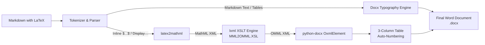

<div align="center">

# 📐 LaTeX → Word Converter

**Generate publication-grade Microsoft Word (`.docx`) documents with native, interactive OMML equations, automatic equation numbering, and Word VBA automation.**

[](https://python.org)
[](LICENSE)
[](https://learn.microsoft.com/en-us/archive/blogs/murrays/omml-office-math-markup-language)
[](gui/app.py)

[Features](#-key-features) • [Quick Start](#-quick-start) • [GUI Guide](#-gui-application) • [VBA Macros](#-word-vba-macro-suite) • [Architecture](#-architecture--pipeline) • [Examples](#-example-input)

</div>

---

## 💡 Why This Exists

Most Markdown-to-Word tools (like default Pandoc setups) rasterize LaTeX equations into **static bitmap/PNG images** or produce non-standard MathType embeddings. This causes severe issues:
- ❌ Formulas become blurry when scaled, printed, or exported to PDF.
- ❌ Collaborators cannot click into, edit, or adjust symbols inside Microsoft Word.
- ❌ Document font scaling and dark mode break equation appearance.
- ❌ Equation numbering is manually typed or misaligned.

**LaTeX → Word Converter** solves this cleanly by translating LaTeX directly into Microsoft's native **Office Math Markup Language (OMML)**. Every formula is **100% editable** in Word's native Equation Tools ribbon, beautifully anti-aliased with Cambria Math, and optionally auto-numbered in an invisible layout table.

---

## ✨ Key Features

- **Native OMML Generation**: Translates inline (`$...$`) and display (`$$...$$`) math into genuine `<m:oMath>` and `<m:oMathPara>` XML elements inside the OpenXML document tree.
- **Bare Formula Detection**: Recognizes formulas typed **without delimiters** — `f_1 in {0.05, 0.15}`, `E_2[ N_hat * theta_hat_DML | s_1 ] = sum_{k in s_1} w_1k Y_k` — and normalizes informal ASCII math before conversion (`N_hat` → N̂, `sum_` → Σ, `<=` → ≤, `w_1k` → w₁ₖ, `{…}` → set braces). Conservative heuristics keep prose identifiers (`max_size`, `snake_case_name`) untouched, and code fences/spans are never scanned.
- **Auto-Numbered Equations**: Automatic equation numbering using an invisible 3-column table layout (left margin, centered equation, right-aligned numbering tag such as `(1)`).
- **Modern Desktop GUI**:
  - Dark-themed code editor with line numbers, current-line highlight, and
    real-time LaTeX syntax highlighting driven by the shared math tokenizer.
  - **Live conversion preview** in a split pane beside the editor: a white
    "paper" view showing headings, tables, code and Unicode-prettified math
    (fractions, roots, greek, sub/superscripts) exactly as the conversion will
    treat them. The preview follows the editor as you scroll, and **clicking a
    formula jumps to its source** (or vice-versa via scroll sync).
  - **Formula repair tools**: `Ctrl+M` wraps a partial selection as `$…$`
    (or `$$…$$` when multi-line), and the **Formula Inspector** lets you edit a
    formula, preview its normalized form, see whether it converts to Word math
    or will fall back to text, and insert it as inline math, display math, or
    code — all **before** saving anything to disk. The Convert button is now
    *Convert & Save*, making the vet-then-save flow explicit.
  - Menu bar with keyboard shortcuts: `Ctrl+O` open, `Ctrl+S` save output,
    `Ctrl+F` find & replace (with match count), `F3`/`Shift+F3` find next/prev,
    `Ctrl+M` wrap as formula, `F5` refresh preview, `Ctrl+Return` convert & save.
  - Live equation counter and status bar (caret position, word count,
    display/inline equation counts).
  - Template dropdown / Insert menu for quick insertion of fractions,
    summations, integrals, and matrices.
  - Options persisted to `~/.latex-to-word-converter.json` (window geometry,
    numbering format, output folder), plus optional auto-open after conversion.
  - Non-blocking asynchronous conversion with progress indicator, a status log
    listing any failed formulas by line number, and 1-click **Open File** /
    **Open Folder** actions upon completion.
- **CLI & Python API**: Effortless headless execution for batch jobs or automated CI/CD documentation pipelines.
- **Word VBA Automation Suite**: Bundled `.bas` macro module for dynamic in-Word equation renumbering and cross-reference generation (`Eq. (n)`).
- **Academic Typography**: Enforces standard academic formatting (1-inch margins, Times New Roman 12pt body, 1.15 line spacing, 6pt spacing after paragraphs).

---

## 🏗 Architecture & Pipeline



---

## 🚀 Quick Start

### 1. Prerequisites & Installation

Ensure you have Python 3.8 or later installed:

```bash
git clone https://github.com/Timoyaj/latex-to-word-converter.git
cd latex-to-word-converter
pip install -r requirements.txt
```

> **Note:** the bundled `core/MML2OMML.XSL` is used automatically. To point at
> a different stylesheet (e.g. from an Office installation), set the
> `LWX_MML2OMML_XSL` environment variable to its full path.

### 2. Launch the Desktop GUI

```bash
python main.py
```

### 3. Command-Line Usage (CLI)

```bash
# Convert with automatic equation numbering
python -m core.converter input.md output.docx

# Convert without equation numbering
python -m core.converter input.md output.docx --no-number

# Custom equation number format (e.g., "[Eq. 1]")
python -m core.converter input.md output.docx --eq-format "[Eq. {n}]"
```

### 4. Python API Usage

```python
from core.converter import LatexToWordConverter

converter = LatexToWordConverter()

markdown_text = """
# Quantum Harmonic Oscillator

The energy eigenvalues for quantum state $n$ are:

$$
E_n = \\hbar \\omega \\left( n + \\frac{1}{2} \\right)
$$
"""

stats = converter.convert_markdown_to_docx(
    markdown_content=markdown_text,
    output_path="QuantumOscillator.docx",
    number_equations=True,
    eq_format="({n})"
)

print(f"Converted {stats['equations_converted']} equations successfully!")
```

---

## 🖥 GUI Application

The desktop application (`gui/app.py`) provides an intuitive authoring and conversion environment:

- **Editor**: Multi-line editor styled in Catppuccin Mocha colors with gold/green syntax
  highlighting for mathematical blocks, a line-number gutter, current-line highlight,
  scrollbars, undo/redo, and find & replace.
- **Live Preview pane** (split beside the editor): renders the whole document —
  headings, paragraphs, quotes, lists, code fences, tables and equations — as it
  will convert. Math is shown in Unicode (`\frac{-b \pm \sqrt{b^2-4ac}}{2a}` →
  `(-b ± √(b²-4ac))/(2a)`, `N_h` → `Nₕ`) with auto-numbered display labels.
  The preview tracks the editor's scroll position; clicking any formula selects
  its exact source span in the editor. Press `F5` to force a refresh.
- **Formula repair**: select a partial or delimiter-less formula and press
  `Ctrl+M` to wrap it as `$…$`/`$$…$$`, or open the **Formula Inspector** to
  edit it, inspect the normalized form and conversion status (math zone vs.
  text fallback), and insert it as inline math, display math, or code — vetting
  the whole conversion before anything is written to disk.
- **Menus & shortcuts**: File (`Ctrl+O`, `Ctrl+S`), Edit (find/replace, undo/redo),
  Insert (templates), Help (About). Convert & save with `Ctrl+Return`.
- **Template Library** (toolbar dropdown or Insert menu): one-click insertion of common
  mathematical constructs:
  - Fractions: `$$\frac{a}{b}$$`
  - Summations: `$$\sum_{i=1}^{n} x_i$$`
  - Definite Integrals: `$$\int_{a}^{b} f(x)\, dx$$`
  - Matrices: `$$\begin{pmatrix} a & b \\ c & d \end{pmatrix}$$`
  - Square Roots: `$$\sqrt{a^2 + b^2}$$`
- **Options**:
  - Toggle equation numbering on/off.
  - Customize the numbering template (`({n})`, `Eq. {n}`, `[{n}]`).
  - Destination file picker with auto-suggested naming.

---

## 📜 Word VBA Macro Suite

Located in [`macros/EquationAutoNumbering.bas`](macros/EquationAutoNumbering.bas), this module provides macros for managing equations directly inside Microsoft Word.

### Installation into Microsoft Word

1. In Microsoft Word, press <kbd>Alt</kbd> + <kbd>F11</kbd> to open the VBA Editor (or click **Developer** → **Visual Basic**).
2. Click **File** → **Import File...** (<kbd>Ctrl</kbd> + <kbd>M</kbd>).
3. Select `macros/EquationAutoNumbering.bas`.
4. Save your document as `.docm` (Word Macro-Enabled Document) or import into your global `Normal.dotm`.

### Available Macros

| Macro Name | Description |
| :--- | :--- |
| **`ConvertAllLatexInDocument`** | Converts all `$$…$$` (including **multi-line** blocks) and `$…$` formulas to native Word equations. Currency amounts (`$5.00 … $10.00`) and escaped `\$` are never converted. Optional auto-numbering via **SEQ fields**. |
| **`ConvertSelectionLatex`** | Converts only the currently selected LaTeX text into a Word equation. |
| **`RenumberAllEquations`** | Renumbers all equation tables sequentially. Updates SEQ fields and legacy literal labels — preserving formats like `({n})`, `[Eq. {n}]`, `Eq. {n}` produced by the Python app. |
| **`InsertEquationNumber`** | Inserts a borderless 3-column table at the cursor position with the next sequential equation number ready for manual entry. |
| **`InsertEquationReference`** | Prompts for an equation number and inserts a **live `REF` field** (`Eq. (n)`) that updates when equations are renumbered. |
| **`CountEquations`** | Utility function returning the total count of numbered equation tables. |

Equation tables are tagged with `EqTbl<n>` bookmarks and their number cells
with `EqNum<n>` bookmarks, so cross-references stay correct across renumbering.
Each macro run is a single undo step. See
[`tests/fixtures/vba/manual_test_checklist.md`](tests/fixtures/vba/manual_test_checklist.md)
for the Word acceptance script.

---

## 📝 Example Input

Here is an excerpt from [`examples/sample_equations.md`](examples/sample_equations.md):

```markdown
# Mathematical Physics Sample

Let $\alpha, \beta, \gamma \in \mathbb{R}$ represent scalar parameters. The time-dependent Schrödinger equation:

$$
i\hbar \frac{\partial}{\partial t}\Psi(\mathbf{r}, t) = \left[ -\frac{\hbar^2}{2m}\nabla^2 + V(\mathbf{r}, t) \right] \Psi(\mathbf{r}, t)
$$

### Characteristic Matrix System

$$
\begin{pmatrix} a_{11} - \lambda & a_{12} \\ a_{21} & a_{22} - \lambda \end{pmatrix} \begin{pmatrix} v_1 \\ v_2 \end{pmatrix} = \begin{pmatrix} 0 \\ 0 \end{pmatrix}
$$
```

---

## 📁 Repository Structure

```text
latex-to-word-converter/
├── core/                           # Core conversion library
│   ├── __init__.py                 # Exports LatexToWordConverter
│   ├── converter.py                # LaTeX/Markdown to OMML .docx engine
│   ├── math_tokens.py              # Shared inline/display math tokenizer
│   └── MML2OMML.XSL                # Microsoft MathML-to-OMML XSLT stylesheet
├── gui/                            # Desktop user interface
│   ├── __init__.py
│   └── app.py                      # Tkinter application with live syntax highlighting
├── macros/                         # Word automation
│   └── EquationAutoNumbering.bas   # VBA macros: convert, renumber, live cross-refs
├── examples/                       # Sample documents
│   ├── sample_equations.md         # Full Markdown test suite with 10 display equations
│   └── sample_equations.docx       # Compiled native Word reference document
├── tests/                          # Pytest suite & fixtures
│   ├── fixtures/md/                # Markdown input fixtures
│   ├── fixtures/expected/          # Structural goldens for generated docs
│   ├── fixtures/vba/               # Word fixtures + manual macro checklist
│   ├── test_math_tokens.py         # Tokenizer unit tests
│   ├── test_clean_latex.py         # LaTeX cleaner unit tests
│   ├── test_converter_docx.py      # Engine integration tests
│   ├── test_cli.py                 # CLI tests
│   └── test_gui_smoke.py           # GUI smoke tests (skip headless)
├── .github/workflows/ci.yml        # GitHub Actions: pytest on Python 3.9–3.12
├── .gitignore                      # Python/Windows/Word gitignore rules
├── LICENSE                         # MIT License
├── main.py                         # Application entrypoint launcher
├── README.md                       # Comprehensive documentation
├── requirements.txt                # Python package dependencies
└── requirements-dev.txt            # Test dependencies (pytest)
```

---

## 🧪 Testing & Fixtures

The project ships with a pytest suite and a fixture pack under [`tests/`](tests/):

```bash
pip install -r requirements.txt -r requirements-dev.txt
python -m pytest tests/
```

- `tests/fixtures/md/` — Markdown inputs covering inline/display math,
  numbering formats, pipe tables with math, code fences, currency/escape edge
  cases, and deliberate conversion failures.
- `tests/fixtures/expected/` — structural goldens (equation counts, table
  counts, numbering labels) asserted against the generated `.docx` XML.
- `tests/fixtures/vba/` — Word documents plus a
  [manual test checklist](tests/fixtures/vba/manual_test_checklist.md) for the
  VBA macro suite (regenerate the documents with
  `python tests/fixtures/vba/make_fixtures.py`).
- `tests/test_math_tokens.py`, `tests/test_clean_latex.py` — unit tests for the
  shared tokenizer and LaTeX cleaner (regression-locked for `$5.00` currency,
  `\$` escapes, `\middle`, and `\mathbb` handling).
- `tests/test_converter_docx.py`, `tests/test_cli.py`, `tests/test_gui_smoke.py`
  — integration tests for the engine, CLI, and GUI (GUI tests skip headless).

CI runs the suite on Python 3.9–3.12 via GitHub Actions
([`.github/workflows/ci.yml`](.github/workflows/ci.yml)).

---

## 🤝 Contributing

Contributions, bug reports, and feature requests are welcome!
1. Fork the repository.
2. Create your feature branch (`git checkout -b feature/NewFeature`).
3. Commit your changes (`git commit -m 'Add NewFeature'`).
4. Push to the branch (`git push origin feature/NewFeature`).
5. Open a Pull Request.

---

## 📄 License

Distributed under the **MIT License**. See [`LICENSE`](LICENSE) for details.
